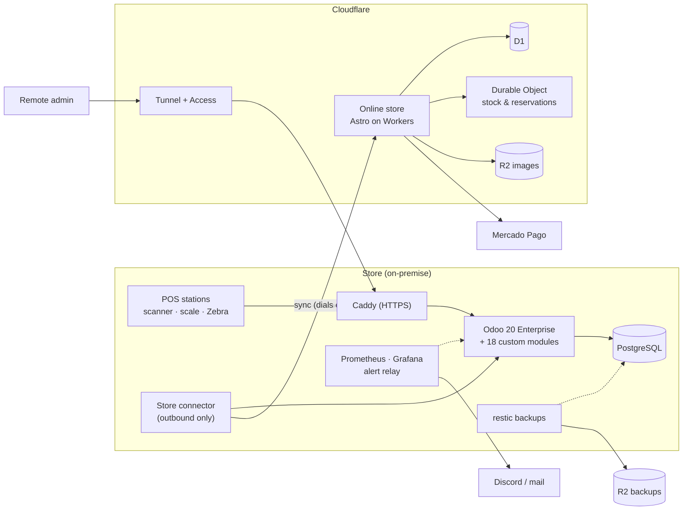

# Odoo Implementation as Code

**A real, end-to-end Odoo 20 implementation for a multi-activity retail business, built so it can be
rebuilt from scratch: configuration as code, custom modules, an online store, a hardened on-premise
server, backups, monitoring and automated tests.**

[Versión en español](README.es.md)

> **About this repository.** This is an anonymized export of a private, in-production project.
> It is generated by a script that copies only an allow-list of files, replaces the business,
> people, suppliers, domains and infrastructure identifiers with fictional ones, and then audits
> the result (forbidden terms, Cloudflare/Tailscale identifiers, hostnames, e-mails, tax IDs,
> phone numbers and anything shaped like a key or token, plus [gitleaks](https://github.com/gitleaks/gitleaks)).
> The business survey, the meeting notes, the open-questions log and the day-to-day journal are
> not included, so some links inside the docs point to files that are not here. History starts
> fresh. The code, docs and comments are in Spanish because that is the working language of the
> business; this README is the English entry point.

---

## The problem

A single physical store runs several businesses under one roof (hardware store, pet supplies,
veterinary and more) with no central system: dozens of supplier price lists in every possible
spreadsheet format, cash registers that are not connected to stock, and no online store.

The goal was not just "have Odoo running", but an implementation that can be **reproduced,
versioned, tested and recovered**, adopted gradually by non-technical staff:

> *We can rebuild this Odoo implementation without relying on anyone remembering each manual
> setting we made.*

## What is in here

| Area | What was built |
|---|---|
| **Configuration as code** | `odoo-iac`: a small, generic tool that applies the desired state of Odoo from layered YAML (`config/base`, `onpremise`, `ejemplos`) through the JSON-2 API, with `plan` (dry run), `apply` and `verify` (reads Odoo back and checks the real state). Idempotent. |
| **18 custom Odoo modules** | Supplier price lists inside Odoo (import any format, column auto-detection, own similarity engine to match products, cost from list price with chained discounts/VAT/USD rate, price history, background apply). Sale price by category margin. POS order printed with a QR at a counter and charged at another register, across two registers. Serial scale read from the browser (WebSerial). Argentine fiscal ticket. Cash-register Z closing (manual or from a photo). Supplier invoices read and matched to the catalog. Stock counting with a barcode reader. ZPL labels straight to a Zebra printer. |
| **AI, carefully scoped** | Gemini (own API key) only *suggests*: whether a supplier row is a product we already have, what is wrong with a broken row, POS categories, reading a price list from a photo. Only what it confirms with high confidence is applied automatically, and it never creates products. If there is no internet or the AI fails, the normal flow continues silently. |
| **Online store** | Its own store on Cloudflare: Astro on Workers, D1, a Durable Object as the stock authority (all-or-nothing reservations), R2 for images, Resend for mail, Mercado Pago Orders API. A connector inside the shop **dials out** to sync with Odoo, so the on-premise server is never exposed. Retail and wholesale sites from the same Worker, an admin panel with roles. |
| **On-premise server** | Debian 13, RAID 1, LUKS unlocked by the TPM, Caddy with Let's Encrypt DNS-01, remote access through Cloudflare Tunnel + Access and Tailscale, segmented access for the store PCs. |
| **Backups & recovery** | restic to a USB drive and Cloudflare R2, nightly, with alerts and **restore tests** (a backup never restored does not count). The lab can be rebuilt from the latest production backup, neutralized. |
| **Observability** | Prometheus + Grafana provisioned from the repo: server, PostgreSQL and business dashboards, alert rules with thresholds, a small relay that de-duplicates and groups alerts into Discord (mail only for critical ones). |
| **Tests** | Unit tests for the engines (similarity, costs, AI pacing, alert relay…), end-to-end tests against a disposable Odoo lab for every flow (POS, two registers, scale, price lists, invoicing, store sync, accounts, orders), and tests for the store. |
| **Decisions** | 38 ADRs explaining *why* (and what was rejected), plus runbooks for operating, installing and recovering everything. |

## Architecture



## Repository layout

```
addons/          custom Odoo modules (comercio_*)
src/odoo_iac/    generic configuration-as-code tool (no client logic)
config/          desired state of Odoo, in layers (base, onpremise, ejemplos)
environments/    targets (lab, onpremise), no secrets
infra/           Docker Compose (lab + on-prem), server scripts, backups, monitoring, Windows helpers
integrations/    supplier-list engine, scale protocol, store connector
web/tienda/      online store (Astro on Cloudflare Workers)
tests/           unit tests + end-to-end tests against the lab
docs/            ADRs (decisiones/), runbooks, infrastructure, inventory of custom code
```

## How it was approached

- **Standard first.** For every need: standard Odoo → configuration → automation → integration →
  custom module. Code only when configuration does not solve it, and every piece of custom code
  is inventoried with the Odoo internals it touches and how it is tested (`docs/codigo-propio.md`).
- **Lab first.** Every change runs in a disposable lab and its end-to-end tests before reaching
  production. Production deploys always take a backup first.
- **Verify, don't trust.** Automations read Odoo back and check the resulting state; an API that
  answered "ok" is not proof.
- **Gradual adoption.** Minimal screens per role, hide rather than remove, start with one business
  (the hardware store) and grow.
- **Nothing hidden.** Fiscal flows follow Argentine regulations; electronic invoicing (CAE) tested
  against the tax authority's sandbox.

## Running it

The lab runs with Docker Compose (`make lab-init`, `make plan`/`apply`/`verify ENV=lab`,
`make test`, `make e2e-*`). It targets **Odoo 20 Enterprise**, which is proprietary and **not
included**: you need your own access. Modules whose dependencies are all Community work on
Community. The store runs with `npm` + Wrangler (`web/tienda`).

## Licenses

- **Odoo modules (`addons/`)**: LGPL-3, except the five that depend on Odoo Enterprise modules
  (`comercio_cierre_z`, `comercio_conteo_catalogo`, `comercio_factura_proveedor`,
  `comercio_libro_iva`, `comercio_pos_ticket_ar`), which are **OPL-1**, the license Odoo requires
  for modules that depend on Enterprise. See each `__manifest__.py`.
- **Everything else**: MIT (see `LICENSE`).
- No Odoo Enterprise code is included in this repository.

## Author

Designed and built by [Josias Tomas Ñañez](https://github.com/JosiasTomasnanez): requirements
discovery with the business, architecture, development, infrastructure and operation, working with
an AI coding assistant (Claude Code).
